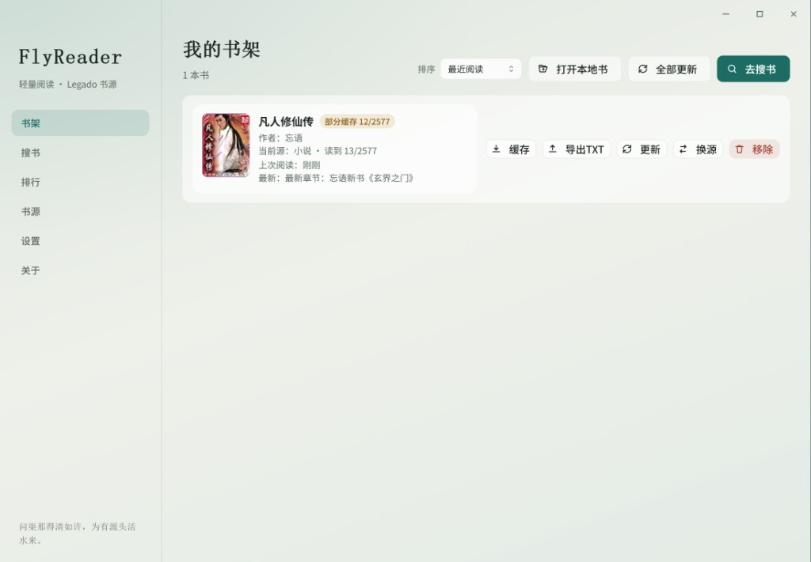

# FlyReader

[](https://gitee.com/wucc513721/flyreader)
[](LICENSE)
[](https://gitee.com/wucc513721/flyreader/releases)
[](https://gitee.com/wucc513721/flyreader)

轻量桌面小说阅读器，支持导入 **Legado（阅读）** 文本书源，提供搜索、书架、离线缓存与阅读设置。
本项目是 [FlyNovel](https://gitee.com/wucc513721/fly-novel)（Electron 版）的 **Tauri 2 重写版**：功能与界面延续，主进程换成 Rust，安装包从 **108MB → 5.3MB**。

- **作者：** 飞鸟传说
- **QQ：** 17472439
- **邮箱：** 17472439chaochao@gmail.com
- **仓库：** https://gitee.com/wucc513721/flyreader
- **许可证：** MIT（开源）

## 运行界面

| Windows · 书架 | macOS · 排行 |
| --- | --- |
|  |  |

## 功能概览

- 导入 Legado 书源（本地文件 / URL 订阅），支持按当前筛选导出 JSON；**一键在线获取**社区书源仓库并自动导入（内置 tickmao / XIU2 / yckceo，支持自定义订阅 URL）
- 多书源并发搜索、书源测试与管理（测试自动换关键词，避免单词误判；失效源搜索命中自动恢复）
- 书架、换源、全部更新；条目显示上次阅读相对时间与缓存进度
- 打开本地 TXT / EPUB / **Markdown**（`.md` / `.markdown`；自动分章，书架标注「本地」；解析放在 `spawn_blocking` 计算线程，不卡界面，带 zip bomb 防护与 5 分钟超时）
- Markdown 以 **GitHub / Gitee 风格**渲染（标题、列表、表格、代码块、徽章等）；目录点击跳转锚点，滚动时左侧目录高亮同步
- 阅读进度、目录、正文净化（含内置网址规则）；← / → 键盘翻章
- 章节离线缓存（SQLite），断网可读已缓存章节；支持整本缓存（可随时取消）与导出 TXT
- 阅读主题：纸感 / 护眼 / 夜间；正文全宽铺满，字号 / 行距 / 系统字体可调；窗口缩放 / 全屏 / 目录开合自动保持阅读位置
- 老板键一键隐藏（默认 <kbd>Ctrl</kbd>/<kbd>⌘</kbd> + <kbd>Shift</kbd> + <kbd>H</kbd>，可在设置里改键）、自动滚屏、护眼/久坐提醒、窗口状态记忆
- Gitee 发行版检查更新，应用菜单与原生「关于 FlyReader」面板

## 与 Electron 版 FlyNovel 的关系

| | FlyNovel | FlyReader（本项目） |
|---|---|---|
| 桌面壳 | Electron + Chromium | Tauri 2 + 系统 WebView |
| 主进程 | Node.js / TypeScript | Rust |
| 界面 | React | 同一套 React，几乎未改 |
| 本地库 | better-sqlite3 | rusqlite（bundled SQLite） |
| 安装包 | 108.5 MB (mac zip) | **5.28 MB (dmg) / 10.9 MB (.app)** |

- **界面复用方式：** 渲染层通过 `frontend/src/tauri/shim.ts` 重新实现了旧版 preload 暴露的 `window.fly` API（签名一致，底层换成 `invoke()` + 事件 `listen()`），所以 6 个视图与 `App.tsx` 基本无需改动。旧版主进程的 45 个 `ipcMain.handle` 通道全部移植为 snake_case 的 Tauri 命令，事件通道同样从 `shelf:cache-progress` 改成 `shelf_cache_progress`。
- **数据兼容：** 旧版数据目录是 `~/Library/Application Support/fly-novel/`，新版是 `com.flyreader.desktop/`。首次启动若新版库不存在，会用 SQLite 在线备份 API 把旧库**只读快照**进新目录——旧库不会被改名、删除或写入。设置页的「旧版数据」面板还能按表合并导入（`INSERT OR REPLACE` / 章节 `INSERT OR IGNORE`）。
- **刻意保留的差异：** 见下文「书源兼容说明」中标注的 4 处引擎修复，只在本版本修好，旧版行为不变。

---

## 环境要求

- **Rust** 1.77+（Tauri 2 的最低版本；本项目在 1.98 stable 上开发）
- **Node.js** 18+（推荐 20 LTS）与 **npm** 9+
- Tauri 2 的[平台依赖](https://v2.tauri.app/start/prerequisites/)：
  - macOS：Xcode Command Line Tools
  - Windows：MSVC 生成工具 + WebView2 运行时
  - Linux：`webkit2gtk-4.1` 及 GTK 相关依赖
- 说明：`rusqlite` 用 `bundled` 特性从源码编译 SQLite，**首次构建较慢**（Intel 机器从全量编译到出 dmg 约 8 分钟，之后增量约 4 分钟）。

## 安装依赖

仓库已配置 `.npmrc`（npmmirror 镜像）：

```bash
git clone https://gitee.com/wucc513721/flyreader.git
cd flyreader
npm install
```

Rust 依赖走 crates.io；如需国内镜像，可配置 `~/.cargo/config.toml` 的 `rsproxy`/ustc 源。

## 开发运行

```bash
npm run dev          # tauri dev：自动拉起 Vite（127.0.0.1:1420）并编译运行 Rust 端
npm run dev:fe       # 只起前端 dev server
cargo test --lib      # 93 个单元测试（src-tauri 目录下执行）
```

提示：

- Vite 端口 `1420` 为 `strictPort`。若已有 dev server 在跑，可只重启 Rust 端：`cd src-tauri && cargo run`，它会连上现有前端。
- 改 Rust 代码由 `tauri dev` 增量重编；改前端一般热更新即可。
- 两个联网测试默认 `#[ignore]`，需要显式跑：

```bash
cargo test --test spike -- --ignored --nocapture          # 真实书源搜索/目录/正文链路
cargo test --test online_repo -- --ignored --nocapture    # 在线书源仓库抓取
cargo test --lib update_check::tests::live -- --ignored --nocapture  # Gitee 发行版检查
```

## 打包

```bash
npm run build                 # tauri build：先 npm run build:fe，再按 tauri.conf.json 打包
npm run build:win             # Windows：只打 NSIS 安装包（不依赖 WiX / MSI）
npx tauri build --bundles app,dmg   # macOS：同时保留 .app 目录，调试更快
npm run icons                 # 由 src-tauri/app-icon.png 重新生成全套图标
```

产物位置与体积（macOS x64，v1.1.0 实测）：

| 产物 | 路径 | 体积 |
|------|------|------|
| `.app` | `src-tauri/target/release/bundle/macos/FlyReader.app` | 10.9 MB |
| `.dmg` | `src-tauri/target/release/bundle/dmg/FlyReader_1.1.0_x64.dmg` | 5.28 MB |

- **Windows / Linux 建议在对应平台打包**：`bundle.targets` 为 `nsis`/`appimage`/`deb`（Windows 默认只打 NSIS，避免 WiX/MSI 额外依赖）；在 macOS 上非 Apple 目标会被静默跳过，`--bundles` 只接受 `app`/`dmg`。必须在含 `src-tauri/tauri.conf.json` 的仓库根目录执行 `npm run build`。
- **未签名**：当前配置与旧版一致地不做代码签名，本机可直接运行；但从网上下载的副本会带 quarantine 属性，需要在「隐私与安全性」里允许打开，彻底解决需要 Developer ID 证书 + 公证。
- 图标源文件是 `src-tauri/app-icon.png`（1024×1024）。`npm run icons` 会覆写 `src-tauri/icons/icon.png`，**不要**拿它当输入源，否则每次生成都会被降采样。

数据目录（macOS）：`~/Library/Application Support/com.flyreader.desktop/fly-reader.sqlite`

---

## 技术栈

| 层级 | 技术 |
|------|------|
| 桌面壳 | Tauri 2（系统 WebView，macOS 用 WKWebView） |
| UI | React 18 + TypeScript |
| 构建 | Vite 5 + @tauri-apps/cli |
| 本地存储 | Rust + rusqlite（bundled SQLite，含 backup / chrono 特性） |
| HTTP | reqwest（gzip / brotli / deflate）+ encoding_rs 编码转换 |
| 书源解析 | scraper（CSS）、sxd-document + sxd-xpath（XPath）、jsonpath-plus（JSONPath）、regex |
| `@js` 规则 | rquickjs（QuickJS）沙箱 |
| 加密 | aes + cbc（书源 `java` 桥的 AES 解密）、base64、sha1_smol |
| 本地 TXT / EPUB | 自写分章 + 编码探测；zip（EPUB 解压） |
| Markdown | marked（GFM）+ DOMPurify（HTML 消毒） |
| 系统集成 | tauri-plugin-global-shortcut（老板键）、tauri-plugin-window-state、tauri-plugin-dialog（原生文件框）、font-kit（系统字体） |

体积来自 `[profile.release]`：`lto = "fat"`、`codegen-units = 1`、`opt-level = "s"`、`strip = true`。
刻意**不设** `panic = "abort"`：本地书解析跑在 `spawn_blocking` 里，panic 需要能展开成「导入失败：…」而不是让进程退出。

---

## 书源兼容说明

兼容常见 Legado 文本书源字段：`searchUrl`、`ruleSearch`、`ruleBookInfo`、`ruleToc`、`ruleContent`。

引擎支持：

- CSS 选择器（`@text` / `@html` / `@href` / `@src` / `@ownText`）
- XPath、JSONPath
- `##` 正则替换（Rust regex 无先行断言，`(?=…)` 形式的拆分改写成了捕获组）
- `{{key}}` / `{{page}}` 与 POST 请求
- `@js` 规则：在 QuickJS 沙箱中执行，2 秒超时；以**非严格模式**求值以匹配 Node `vm` 行为，并暴露 `result` / `baseUrl` 等绑定
- HTTP 状态码校验（4xx / 5xx 视为该源失败，不影响其他源）

相对 Electron 版**新增的 4 处修复**（真实书源上验证，旧版未修）：

1. `parse_header` 兼容 JS 对象字面量（单引号 / 注释 / 尾逗号）——旧版直接用 `JSON.parse`，导致这类源的 `client-*`、`Authorization` 头被静默丢弃。
2. 识别 `ruleBookInfo.init`（如 `"$.data"`）对响应重新定位根节点——否则详情页显示「未知书名」、目录 URL 丢 id。
3. 注入 `java` 桥（`aesBase64DecodeToString`、`createSymmetricCrypto(...).decryptStr`，AES-CBC/PKCS7），并支持 `左规则@js:代码` / `左规则<js>代码</js>` 链式写法——部分 API 书源的章节 URL 是 AES 加密的。
4. JSON 规则会剥离结尾的 `@getType`（正文按 HTML 处理时 `$.content` 会变成非法 JSONPath `$.content@html`）。

暂不支持：依赖 WebView 渲染的规则、需要登录态的书源、听书等非文本类型。

---

## 目录结构

```
flyreader/
├── frontend/
│   └── src/
│       ├── App.tsx / main.tsx        # 界面入口
│       ├── views/                    # 书架 / 搜索 / 阅读 / 书源 / 设置 / 关于
│       ├── components/ hooks/ utils/ # 封面、虚拟列表、进度、老板键等
│       ├── shared/                   # 与旧版共用的类型、正文净化、搜索相关性、关于信息
│       └── tauri/shim.ts             # window.fly 垫片（invoke + 事件订阅）
├── src-tauri/
│   ├── src/
│   │   ├── commands.rs               # 全部 Tauri 命令与长任务（搜索/缓存/更新/导出）
│   │   ├── store.rs / db.rs          # SQLite 存取、旧版数据继承
│   │   ├── engine/                   # Legado 引擎：http / rules / legado / text / js / source_repo
│   │   ├── local_books/              # TXT 分章 / Markdown / EPUB / 导入合并
│   │   ├── boss_key.rs / app_menu.rs / theme.rs  # 全局快捷键、应用菜单与关于、主题背景
│   │   ├── relevance.rs              # 搜索结果相关度与书源排序
│   │   └── update_check.rs           # Gitee 发行版检查
│   ├── capabilities/default.json     # 权限（core:default / dialog / 窗口拖拽）
│   ├── icons/ + app-icon.png         # 图标
│   ├── tests/                        # spike.rs / online_repo.rs（联网，默认 ignore）
│   └── tauri.conf.json
├── package.json / vite.config.ts / tsconfig.json
└── README.md
```

---

## 常见问题

**Q: 点检查更新提示「仓库尚未发布发行版」？**
A: 说明本仓库还没有带 `tag_name` 的 Release。发布后这里会正常显示最新版本并给出下载链接。

**Q: 双击下载的 dmg 提示无法打开？**
A: 未签名包的 quarantine 限制，右键「打开」或在「隐私与安全性」允许即可；本机 `npm run build` 出来的产物不受影响。

**Q: 老板键设置失败提示「可能被占用」？**
A: 该组合键已被其他应用注册。换一个组合，或在设置里关掉老板键。macOS 上快捷键注册必须离开主线程执行，代码里已按此实现。

**Q: 标题栏拖不动窗口？**
A: WKWebView 不支持旧版的 `-webkit-app-region: drag`，本版本在侧栏、顶栏、目录面板头部与阅读工具条上改用 `data-tauri-drag-region` 标注（并开放 `core:window:allow-start-dragging` 权限）。若在自定义界面里新增可拖拽区域，照这个写法加。

**Q: Windows 为什么没有「文件 / 编辑 / 查看」菜单栏？**
A: 刻意去掉了。原生菜单栏会占一整行，观感与 macOS 沉浸式顶栏不一致；Windows / Linux 改为无边框窗口 + 右上角自定义按钮，重载 / 缩放快捷键（Ctrl+R、Ctrl+0/=/-）仍可用。

**Q: 书架/设置突然是空的？**
A: 数据固定在 `Application Support/com.flyreader.desktop`。旧版数据在 `fly-novel/`，新版只读继承；若目录被改动，可在设置页「旧版数据」面板重新合并。

---

## 开源说明

本软件以 **MIT** 许可证开源。使用、修改、分发时请保留版权与许可声明（导出的 TXT 会在结尾附上署名）。

主要开源组件：

| 组件 | 用途 | 许可 |
|------|------|------|
| Tauri 2 | 桌面壳 | MIT |
| React | UI | MIT |
| TypeScript | 语言与编译 | Apache-2.0 |
| Vite | 构建 | MIT |
| rusqlite + libsqlite3-sys | 本地数据库 | MIT |
| reqwest / encoding_rs | HTTP 与编码转换 | MIT / Apache-2.0 |
| scraper / sxd-document / sxd-xpath | HTML / XML / XPath 解析 | MIT / Apache-2.0 |
| jsonpath-plus | JSONPath | MIT |
| rquickjs | `@js` 规则沙箱 | MIT |
| aes / cbc / base64 / sha1_smol | 书源加密与 ID 生成 | MIT / Apache-2.0 |
| zip | EPUB 解压 | MIT |
| marked / DOMPurify | Markdown 渲染与消毒 | MIT / MPL-2.0 |
| font-kit | 系统字体列表 | MIT / Apache-2.0 |

---

## 更新记录

- **2026-09-29 · v1.1.0** — Tauri 2 重写版（FlyReader）
  - 主进程整体迁移到 Rust：存储、Legado 引擎、本地书导入、书架长任务、检查更新
  - 界面复用旧版 React 渲染层，经 `window.fly` 垫片调用 Tauri 命令
  - 只读继承 Electron 版数据库；设置页保留「旧版数据」合并入口
  - 引擎修好 4 类真实书源问题（JS 字面量请求头、`ruleBookInfo.init`、`java` AES 桥与链式 `@js`、`@getType` 后缀）
  - 全局快捷键老板键、应用菜单与原生关于面板、主题背景色与窗口外观对齐
  - 包体 108.5 MB → **5.28 MB**；新增 93 个 Rust 单元测试与 2 个联网验收测试
- FlyNovel（Electron 版）的历史更新见 [fly-novel README](https://gitee.com/wucc513721/fly-novel)。

---

## License

MIT © 飞鸟传说
